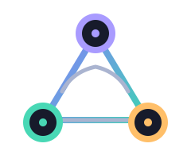
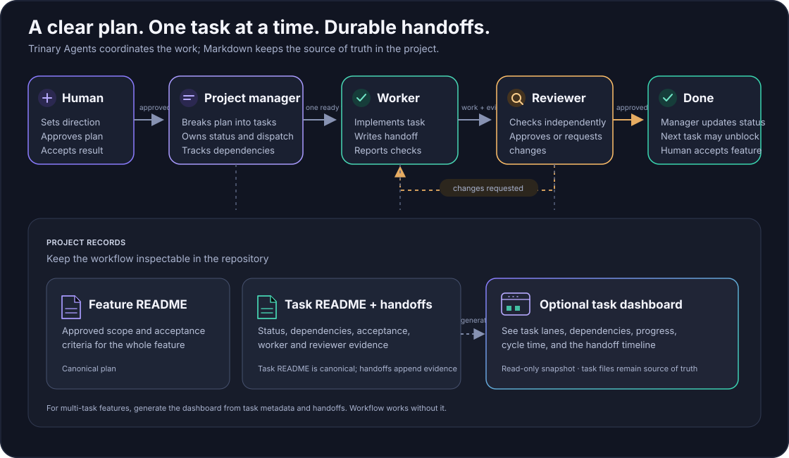
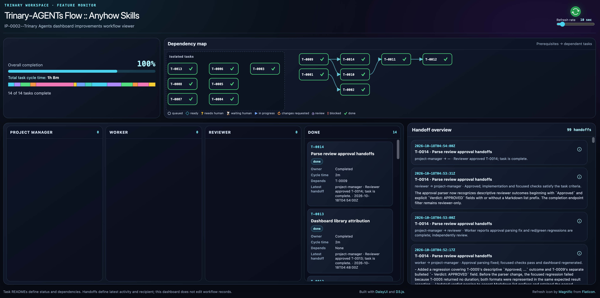

<p align="center">
  
</p>

<h1 align="center">trinary-agents</h1>

<p align="center">
  An agent-harness-agnostic workflow for planning and delivering feature work.
</p>

<p align="center">
  Human-approved plans, dependency-aware tasks, independent review, and durable Markdown handoffs.
</p>

<p align="center">
  <a href="skills/">Skills</a>
  ·
  <a href="https://github.com/inotives/trinary-agents/releases">Download releases</a>
  ·
  <a href="docs/skill-releases.md">Release and versioning policy</a>
  ·
  <a href="LICENSE.md">MIT License</a>
</p>

---

## What This Repository Contains

`trinary-agents` is a focused home for skills and supporting tools for a
project-manager, worker, and reviewer workflow. The core workflow uses ordinary
Markdown files so plans, tasks, and handoffs remain readable across agent
harnesses. It aims to work with Codex, Claude, Pi, OpenCode, and other agents
that provide delegation capabilities.

Harness-specific discovery or installation instructions can be added alongside
the core skills without making those integrations requirements of the workflow.

## Why This Project Exists

I created [AgentRig](https://github.com/inotives/agent-rig) to scaffold and run
multi-agent workflows using configurable agent profiles. It defaults to SQLite
for workflow state and also supports Markdown storage.

Even with that tooling, I found the initial setup could feel difficult, and
ad-hoc tasks could feel disconnected from the ongoing workflow. That experience
led me to express the tri-agent workflow as portable skills with plain Markdown
plans, task records, and handoff logs. The goal is to make the workflow easier
to start and keep its activity visible in the project, without requiring a
dedicated runtime or database.

## Skill Model

Each skill lives in its own directory and can be copied independently:

```text
skills/
└── <skill-name>/
    ├── SKILL.md          # purpose, trigger, workflow, requirements, limits
    ├── VERSION           # independent SemVer version for this skill
    ├── CHANGELOG.md      # per-version notes used for GitHub Releases
    ├── assets/           # optional bundled resources
    ├── references/       # optional detail loaded only when needed
    ├── scripts/          # optional supporting tools
    └── tests/            # optional checks for supporting tools
```

`SKILL.md` is the source of truth for each skill. Add scripts and tests only
when a skill needs them; keep the core instructions portable and document any
runtime assumptions at the skill that introduces them. Each skill is released
and versioned independently. When a pull request changes a skill, increment
that skill's `VERSION`; GitHub checks this before allowing the merge. See the
[release policy](docs/skill-releases.md).

## Skills

| Skill | What it does |
| --- | --- |
| [Trinary Agents](skills/trinary-agents/SKILL.md) | Plan feature work, track dependencies, coordinate implementation and independent review, and preserve decisions in Markdown handoffs. |
| [Trinary Rapid](skills/trinary-rapid/SKILL.md) | Deliver a small, well-bounded feature or fix fast: a short interview, one plan approval, one independent review, and a templated report rendered to HTML. |
| [Trinary Workspace Backup](skills/trinary-workspace-backup/SKILL.md) | Back up, verify, and restore `trinary-workspace/` through a connected Google Drive integration. |

Download the latest ZIP releases from the
[GitHub Releases](https://github.com/inotives/trinary-agents/releases) page.
Each release ZIP contains the skill folder at its root.

To install Trinary Agents in your project, run one of these from the project
root:

```sh
# Codex
npx skills add inotives/trinary-agents --skill trinary-agents --agent codex

# Claude Code (installs to .claude/skills/trinary-agents/)
npx skills add inotives/trinary-agents --skill trinary-agents --agent claude-code
```

To install Trinary Rapid, use the same commands with `--skill trinary-rapid`:

```sh
# Codex
npx skills add inotives/trinary-agents --skill trinary-rapid --agent codex

# Claude Code (installs to .claude/skills/trinary-rapid/)
npx skills add inotives/trinary-agents --skill trinary-rapid --agent claude-code
```

For the Claude app (not Claude Code), download the skill ZIP from GitHub
Releases and upload it from **Customize → Skills**. See Anthropic's guide to
[using skills in Claude](https://support.claude.com/en/articles/12512180-use-skills).

Claude Code runs the worker and reviewer as separate sub-agents through its
`Agent` tool, which satisfies the independent review gate.

## How the Workflow Works



The human approves the feature plan once. The project manager then breaks it
into dependency-aware tasks, validates the task graph, commits the plan and task
baseline, and dispatches ready work. There is no separate approval for the task
breakdown; material changes to the approved scope still need human approval.

### Decision flow

The project manager runs one task at a time through the loop below. Any point
that needs a human decision (marked **H**) pauses the whole feature until the
human responds; when a specific task needs the decision, it is set to
`blocked`. Out-of-scope follow-ups and
acceptance limitations go to the backlog, where the human can later promote
one into the next feature plan.


### Backlog

The backlog holds ideas and bugs that are not part of an approved feature yet.
Each item is one Markdown file in
`trinary-workspace/backlog/BL-XXXX--<item-slug>.md` with a `type` of `idea` or
`bug`; the template and rules are in the skill's `SKILL.md`.

- **Capture.** Items come from the human ("add this to the backlog"), from
  `Follow-ups` in worker and reviewer handoffs, and from limitations found
  during feature acceptance. The project manager writes every item and tells
  the human which ones it added. Follow-ups never change the current task's
  scope.
- **Discuss.** Ask to go through the backlog and the project manager lists the
  `open` and `discussing` items. Pick one to shape; each discussion round is
  appended to the item with the human's input preserved.
- **Promote or drop.** Only the human chooses an item for the next feature. The
  project manager starts a new feature branch, uses the item's notes to seed the
  plan interview, records the item as the plan's `origin`, and marks the item
  `promoted`. Items the human rejects are marked `dropped` with the reason.
  Items are never deleted.
- **Bugs.** A bug goes to the backlog only when it is outside the current
  work: a bug in the task under review is a reviewer finding, and one that
  stops the feature is a blocker. A bug item records reproduction steps and
  expected versus actual behavior. When promoted, the plan interview focuses
  on reproduction and impact, a small fix can be a single-task plan on a
  `fix/` branch, and acceptance must include a check that fails before the
  fix and passes after it.

Backlog changes are committed with the next workflow checkpoint on the current
branch, so items captured on an unmerged feature branch only appear on other
branches after it merges.

For any feature with one or more valid task READMEs, the skill generates a
read-only dashboard for monitoring task status, dependencies, progress, and
handoff activity. Task READMEs remain the source of truth. Each task card has a
top-right details button that opens the full task README in the same sidebar
used for handoff details.
Dashboard generation requires Python 3 and uses only the standard library; no
Python packages need to be installed. Check availability with
`python3 --version`. The skill bundles its DaisyUI stylesheet and embeds it in
each generated dashboard. The page uses browser-native DOM and SVG APIs and
makes no third-party runtime requests. See the skill's
[`SKILL.md`](skills/trinary-agents/SKILL.md) for when to generate it and the
[dashboard reference](skills/trinary-agents/references/dashboard.md) for setup
and page details.

## Trinary Agents UI Dashboard



When a feature is complete, its latest `dashboard.html` can serve as a
self-contained report to share or archive. It shows task outcomes and
implementation/review summaries, plus a timestamped timeline of every handoff
with its role, recipient, outcome, and summary. Regenerate the dashboard after
task status or dependency changes and after adding or changing a timestamped
handoff. The task READMEs and handoff files remain the full, canonical record.

## Trinary Rapid

Trinary Rapid is a lightweight companion to Trinary Agents for small,
well-bounded features and fixes. Use it when the change fits in about five
steps and does not span many modules: the agent runs an interview capped at
two rounds, gets one plan approval, implements the plan itself (with optional
subagents for independent steps), runs one independent review, and writes a
report. There are no task folders, per-task handoffs, or dashboards. Use the
full Trinary Agents workflow for multi-module work, longer plans, questions
still open after the interview, or when you want a dependency-tracked
project-manager, worker, and reviewer loop. Rapid recommends switching when
one of those conditions applies; the human decides.

Each rapid feature lives in its own folder in the shared workspace:

```text
trinary-workspace/rapid/RF-XXXX--<slug>/
├── README.md     # the plan: scope, decisions, acceptance checks, step checklist
├── report.md     # the report, written from a fixed template
└── report.html   # the rendered report
```

The report's Outcome section opens with a single `RESULT:` line,
`RESULT: DELIVERED`, `RESULT: PARTIAL`, or `RESULT: NOT_DELIVERED`, followed
by acceptance check results, changes, findings, review, pending issues, and
completed steps. Out-of-scope pending issues go to the shared
`trinary-workspace/backlog/`.

The skill's renderer validates `report.md` against the template and writes a
self-contained `report.html` with an embedded stylesheet and no network
requests. It requires Python 3 and uses only the standard library. If Python 3
is unavailable, `report.md` remains the deliverable. When `trinary-workspace/`
is ignored by Git, rapid does not force-add it: it commits only the
implementation files and tells the human where the plan and report are. See
the skill's [`SKILL.md`](skills/trinary-rapid/SKILL.md) and
[report reference](skills/trinary-rapid/references/report.md).

## Optional Supporting Skills and Tools

The core workflow works with ordinary Markdown and the repository tools already
available in the active harness. Its feature-planning interview is built into
the Trinary Agents skill; no separate grilling skill is required. These optional
capabilities can help with other steps when available:

| Workflow step | Optional capability | How it can help |
| --- | --- | --- |
| Explore a larger codebase | `context-mode` | Search and summarize repository context without loading large files into the conversation. |
| Navigate symbols and call paths | CodeGraph | Locate relevant code relationships when the repository has an index. |
| Implement and review tasks independently | The active harness's agent delegation feature | Assign worker and reviewer roles to different agents. Independent delegation is needed to perform the independent review gate. |

Sub-agents usually start with little or no repository context. Without
`context-mode` and CodeGraph, they may scan broad parts of the codebase again for
each assigned task, increasing setup time and token use. When available,
`context-mode` can retrieve focused repository context and CodeGraph can surface
relevant symbols and call paths, reducing repeated exploration and saving
tokens. CodeGraph is most useful when the repository has an index.

If an optional search or planning skill is unavailable, use the repository's
normal search, file-reading, and interview workflow. If the harness cannot
delegate an independent reviewer, follow the capability boundary in the core
skill and ask the human how to proceed.

## Workflow Records

The Trinary Agents workflow stores its backlog, feature plans, task briefs, and
handoffs in a `trinary-workspace/` directory at the target project's repository
root. Backlog items capture ideas, bugs, and review follow-ups, hold the discussion
that shapes them, and are promoted into a new feature plan when the human
chooses one. The
skill's `SKILL.md` defines its structure and rules. Workspace records are
project data and are not included in this repository; the directory is ignored
by this repo's `.gitignore`.

## Development Principles

- Keep the smallest complete implementation.
- Keep the core workflow independent of any one agent harness.
- Prefer ordinary Markdown and existing platform capabilities over new services or dependencies.
- Keep each skill independently understandable and copyable.
- Document capability limits and never claim checks that were not run.

## License

This project is licensed under the [MIT License](LICENSE.md).
